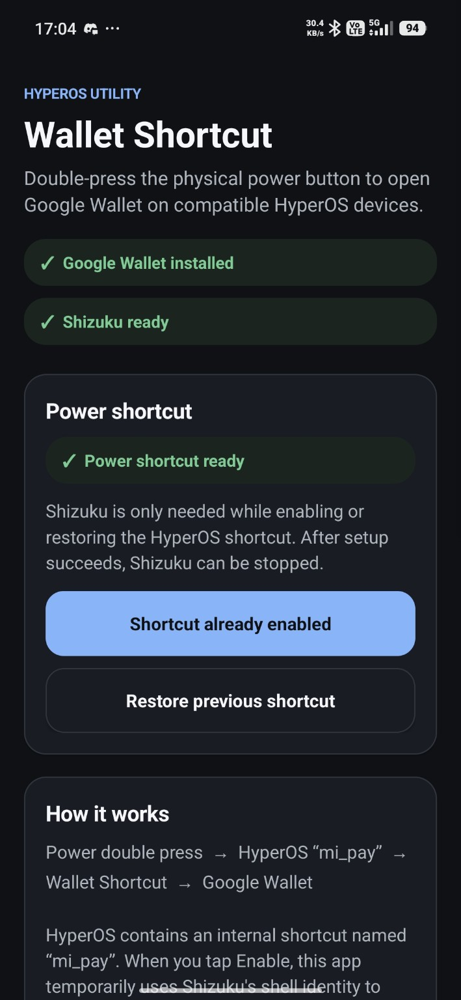
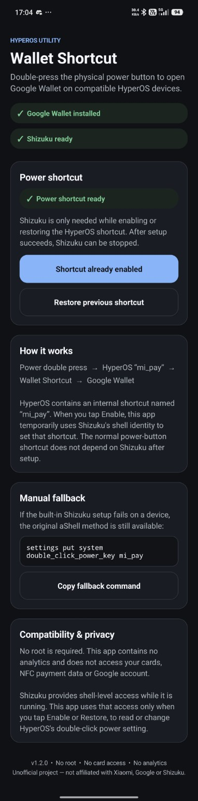

# HyperOS Wallet Shortcut

A rootless HyperOS utility that lets compatible Xiaomi, Redmi and POCO devices open **Google Wallet** by double-pressing the physical power button.

> **Unofficial independent project.** Not affiliated with, endorsed by, sponsored by, or associated with Xiaomi, Google, Shizuku, or their affiliates.

Third-party product names and trademarks are used only to describe compatibility and interoperability. See [`TRADEMARKS.md`](TRADEMARKS.md).

<p align="center">
  
</p>

## About

HyperOS Wallet Shortcut is a small compatibility shim for HyperOS devices where the physical power-button double press cannot normally be assigned to Google Wallet.

It uses HyperOS's internal `mi_pay` shortcut path and forwards that shortcut to Google Wallet.

The app does **not** handle payments itself and does not access your cards, NFC payment data, or Google account.

## What's new in v1.2.1

### Automatic shortcut recovery after reboot

Some HyperOS builds reset the double-press Power shortcut after restarting.

v1.2.1 introduces optional automatic recovery:

- OFF by default, with explicit user consent.
- Checks the shortcut after reboot using Shizuku.
- Restores `mi_pay` if HyperOS resets the setting to null.
- Does not overwrite another non-null shortcut selection.
- Reports recovery failures through notifications and in-app warnings.
- Allows recovery to be disabled at any time.

Recovery timing depends on Android background scheduling and Shizuku availability.

### Recommended: Shizuku-Next

For the best automatic recovery experience, we recommend [Shizuku-Next](https://github.com/rushiranpise/Shizuku-Next).

With a compatible configuration, automatic recovery can work after reboot without Wi-Fi.

We've successfully tested automatic recovery with Wi-Fi disabled, mobile data enabled, and neither app opened manually.

**Important:** Results may vary depending on the device, HyperOS version, and Shizuku configuration. Automatic recovery is not guaranteed on every device.

Once the shortcut is configured, Shizuku can be stopped immediately. The power-button shortcut works without it.

If Automatic recovery is enabled, Shizuku must be configured to start automatically after reboot so the app can check and restore the shortcut if necessary. Shizuku can be stopped again after recovery finishes.

## What's new in v1.2.0

- Improved compatibility with some MediaTek devices using a Shizuku fallback.
- Improved Google Wallet launching, including lock-screen handling.
- Added notifications for Wallet launch errors.
- Added an in-app GitHub update checker.
- Added periodic background update checks and notifications for newer releases.
- Improved status-bar spacing and cleaned up the interface.
- Preserved rootless shortcut setup and restoration.

Background update checks use Android JobScheduler and work over Wi-Fi
or mobile data. Android may delay checks to conserve battery.

## How it works

```text
Power ×2
   ↓
HyperOS "mi_pay"
   ↓
HyperOS Wallet Shortcut
   ↓
Google Wallet
```

HyperOS contains an internal shortcut named `mi_pay`. When that shortcut is selected, HyperOS attempts to launch Xiaomi's wallet package.

This app intentionally uses the package name:

```text
com.miui.tsmclient
```

It receives the HyperOS wallet shortcut and immediately forwards it to Google Wallet.

For setup, the app temporarily uses Shizuku's shell-level access to configure:

```text
double_click_power_key = mi_pay
```

Once that setting has been written, Shizuku can be stopped.

## Requirements

- A compatible Xiaomi, Redmi, or POCO device running HyperOS.
- Google Wallet installed.
- Shizuku installed and running during setup.
- No root required.

## Installation

1. Download the latest APK from the **Releases** page.
2. Install the APK.
3. Start **Shizuku**.
4. Open **HyperOS Wallet Shortcut**.
5. Tap **Enable shortcut with Shizuku**.
6. Grant the app Shizuku permission when prompted.
7. Wait for the app to confirm that the shortcut was enabled.
8. You can now stop Shizuku.
9. Double-press the physical power button to open Google Wallet.

## Restoring your previous shortcut

If the app saved a previous double-press action before enabling Wallet:

1. Start Shizuku.
2. Open HyperOS Wallet Shortcut.
3. Tap **Restore previous shortcut**.
4. The previously saved HyperOS shortcut value will be restored.

## Manual fallback

If the built-in Shizuku setup does not work on a particular device, you can still use the original method.

Run the following command from a Shizuku-authorized shell such as aShell:

```sh
settings put system double_click_power_key mi_pay
```

You only need to run it once unless HyperOS later resets or changes the setting.

To verify the current value:

```sh
settings get system double_click_power_key
```

Expected result:

```text
mi_pay
```

## App preview

<p align="center">
  
</p>

## Features

- Double-press Power to launch Google Wallet.
- Rootless operation.
- Built-in Shizuku setup.
- Optional automatic shortcut recovery after reboot.
- Recovery failure notifications and in-app warnings.
- One-tap shortcut enable.
- Restore previous shortcut.
- Shortcut status detection.
- Google Wallet detection.
- Manual aShell fallback.
- No continuously running background service required for the power-button shortcut.
- No analytics.
- No card or payment-data access.

## Known limitations

- **Reboot reset:** Some HyperOS regional builds reset the shortcut after restarting. Optional automatic recovery can help, but requires Shizuku to become available and is not guaranteed on every device.
- **Compatibility:** Some Xiaomi, Redmi and POCO devices restrict the internal Mi Pay shortcut. Compatibility is not guaranteed.
- **Background updates:** HyperOS battery management may delay automatic update checks and notifications.

## Privacy

HyperOS Wallet Shortcut does not collect analytics or personal information. Update checks make HTTPS requests to GitHub to retrieve public version metadata.

The app does not read or store:

- payment cards
- NFC payment data
- Google Wallet account information
- Google account credentials

Shizuku provides shell-level access while it is running. The app uses that access for manual Enable and Restore actions, and during automatic reboot recovery if you opt in, to read or change the HyperOS double-click power setting.

## Compatibility

The shortcut relies on an internal HyperOS implementation and is therefore not guaranteed to work on every Xiaomi, Redmi, or POCO model.

A future HyperOS update may change or remove the internal shortcut behavior.

If you test the app on another device, compatibility reports are welcome. Useful information includes:

- device model
- HyperOS version
- Android version
- whether Power ×2 successfully opened Google Wallet

## Important package-name warning

This project intentionally uses the Android package identifier:

`com.miui.tsmclient`

This identifier is used solely for interoperability with compatible HyperOS versions, because HyperOS routes its internal `mi_pay` power-button shortcut to that package identifier.

This project is **not** Xiaomi's Mi Pay application, does not contain Xiaomi proprietary code or assets, and is not affiliated with or endorsed by Xiaomi.

**Do not install this app if your device already has Xiaomi's genuine `com.miui.tsmclient` / Mi Pay package installed.**

Android allows only one installed application to own a given package identifier at a time.

For additional trademark and affiliation information, see [`TRADEMARKS.md`](TRADEMARKS.md).

## Why Shizuku is needed

Android's normal `WRITE_SETTINGS` permission is not enough for this HyperOS shortcut setting.

On affected HyperOS builds, attempting to change `double_click_power_key` through the normal app API is redirected/protected as a secure system setting.

Shizuku allows the app to perform the same settings operation through Android's shell identity without requiring root.

## Security

The source code is public so the behavior of the app can be inspected.

The app's privileged setup path is intentionally limited to the HyperOS power-button shortcut configuration. The normal Power ×2 → Google Wallet flow does not require Shizuku to remain running.

If you find a security issue, please follow the instructions in [`SECURITY.md`](SECURITY.md).

## Building

This repository contains the Android source code and Gradle configuration.

The project currently targets:

```text
compileSdk 35
minSdk 23
targetSdk 35
```

Shizuku API integration is included in the app source.

Official releases are signed separately. Do not commit signing keys or keystores to the repository.

## License

Licensed under the **Apache License 2.0**.

See [`LICENSE`](LICENSE) for the full license text.
